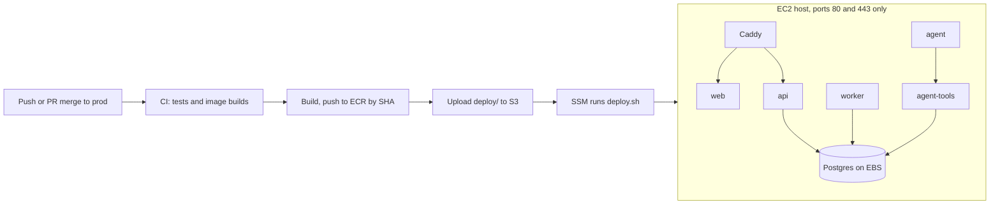

# SettleIQ - Deployment plan

Status: nothing here has been applied to AWS yet. See [section 10](#10-first-deploy-runbook) for the first deploy.

## 1. Summary

SettleIQ runs on one EC2 instance with Docker Compose, with Caddy terminating TLS on one origin. A push to `prod`, which includes a merged PR, tests the commit, builds images tagged with its SHA, pushes them to ECR, and runs `deploy.sh` on the host through SSM. There is no SSH and no AWS key in GitHub. Terraform owns the AWS resources, and Postgres lives on a separate EBS volume that survives instance replacement.

This plan follows the FastAPI code in the repo. The backend stack is still open in `CLAUDE.md`; if the team moves to Node, only the `api` image and the commands in `deploy/compose.yaml` change.



## 2. Service inventory

| Service | Path | Language | Port | Dockerfile | Health | DB | Env vars |
| --- | --- | --- | --- | --- | --- | --- | --- |
| proxy | `deploy/Caddyfile` | Caddy | 80, 443 (only published ports) | upstream image | none | no | `ACME_EMAIL` |
| web | `frontend` | static React build, nginx | 8080 | `Dockerfile.prod` (new) | `GET /` | no | none |
| api | `backend`, `app.main` | Python, FastAPI | 8000 | `Dockerfile` | `GET /healthz` | yes, `settleiq_app` | `DATABASE_URL`, `ENVIRONMENT` |
| worker | `backend`, `app.worker_api` | Python, FastAPI | 8001, private | same image as api | TCP | yes, `settleiq_app` | as api |
| migrate | `backend`, one-shot | Python, Alembic | none | same image as api | exit code | yes, owner | plus `MIGRATION_DATABASE_URL`, `APP_DB_PASSWORD` |
| agent-tools | `backend`, `app.agent_tools_api` | Python, FastAPI | 8002, private | same image as api | TCP | yes, `settleiq_app` | plus `AGENT_TOKEN_SECRET` |
| dispatcher | `backend`, `app.investigation.dispatcher` | Python | none | same image as api | none | yes, `settleiq_dispatcher` | `AGENT_TOKEN_SECRET`, `AGENT_URL` |
| agent | `agent` | Python, FastAPI | 8100, private | `Dockerfile` | TCP | **never** | `LLM_API_KEY`, `AGENT_TOOLS_URL` |
| db | upstream image | PostgreSQL 16 | 5432, private | upstream image | `pg_isready` | n/a | `POSTGRES_*` |

agent-tools, dispatcher and agent are stubs until task 5.7, so they sit behind the `agent` Compose profile, as they do locally.

Isolation matches the local stack: `edge` holds proxy, web and api; `backend` holds the database and its clients; `agent` holds the agent and its two peers. Secrets are passed per service rather than with one shared `env_file`, because spec section 8 forbids the agent from holding database credentials.

## 3. Environments

`prod` only. To add staging: copy `infra/envs/prod`, change the state key and `env`, add a parameter path under `/settleiq/staging/`, and add a second deploy role that trusts the staging branch.

## 4. Infrastructure

| Resource | Why | Approx. monthly cost |
| --- | --- | --- |
| EC2 `t3.medium`, Ubuntu 24.04 | One box to debug | $33 ($0.0448/hr) |
| EBS gp3: 20 GB root, 20 GB data | Data outlives the instance; `prevent_destroy` | about $4 (estimate) |
| Elastic IP / public IPv4 | Stable DNS target | $3.65 |
| ECR (3 repos, last 15 images) | Immutable SHA tags, so rollback is exact | under $1 |
| S3 (state, releases 30 days, backups 14 days) | Remote state, deploy bundles, dumps | under $1 |
| SSM Parameter Store, standard | Secrets | free |

Total is about **$41 a month, or $1.40 a day**. These are approximate; check the AWS pricing page before relying on them.

Idle, the five core containers used about 170 MB in total in a local run, so `t3.medium` (4 GB plus 2 GB swap) has plenty of headroom. That is an idle figure, with no load and the agent profile off. The tech-stack doc suggests about 8 GB; to follow it, set `instance_type = "t3.large"`, which is an in-place stop and start.

State lives in S3 with native locking (`use_lockfile`), created by `infra/bootstrap`.

## 5. Pipelines

| Workflow | Trigger | Jobs | Touches AWS |
| --- | --- | --- | --- |
| `ci.yml` | PRs, push to `prod`, called by `deploy.yml` | backend (real Postgres, `REQUIRE_DB_TESTS=1`), agent, frontend, image builds, Terraform validate, shellcheck | no |
| `deploy.yml` | **push to `prod` only**, ignoring `infra/`, `docs/`, `*.md` | test, build and push, deploy through SSM, public smoke test | yes |
| `infra.yml` | **push to `prod` only**, `infra/**` | terraform plan and apply | yes |

Any failing CI job blocks the deploy.

**CD runs from `prod` and nowhere else.** Three layers enforce this:

1. The workflows trigger only on `push: branches: [prod]`. A merged PR is a push. There is no `workflow_dispatch` or `pull_request` trigger on anything that deploys.
2. Every entry job has `if: github.ref == 'refs/heads/prod'`, in case a trigger is added later.
3. Both AWS roles trust exactly `repo:GODSPEED482/SettleIQ:ref:refs/heads/prod`. A workflow edited on another branch cannot get AWS credentials at all. This is enforced by AWS, so it does not depend on any GitHub setting.

Two consequences:

- Jobs that assume these roles must not set `environment:`, because that changes the OIDC subject and AWS would refuse it.
- PRs get no Terraform plan, because a plan needs the admin-level infra role. PRs run keyless `fmt` and `validate`; `infra.yml` prints the plan in its log before applying. To preview a change, run `terraform plan` locally.

Protect `prod` in GitHub, requiring a PR and passing CI, since a direct push deploys.

`ci.yml` still runs on its own for a push to `prod`, so a deploying push runs the tests twice. That is deliberate: the standalone run also covers pushes that `deploy.yml` ignores.

Image tags are immutable, so "Re-run all jobs" on a finished deploy fails at the push step. Use "Re-run failed jobs".

## 6. Config and secrets

`deploy.sh` renders `.env` on the host from Parameter Store, and refuses to deploy if a required value is still `CHANGE_ME`.

| Name | Secret | Set where | Used by |
| --- | --- | --- | --- |
| `POSTGRES_DB`, `POSTGRES_USER` | no | SSM | db, migrate, connection strings |
| `POSTGRES_PASSWORD` | yes | SSM | db, migrate |
| `APP_DB_PASSWORD` | yes | SSM | migrate (creates the role), api, worker, agent-tools |
| `ACME_EMAIL` | no | SSM | proxy |
| `DISPATCHER_DB_PASSWORD` | yes | SSM | dispatcher (agent profile) |
| `AGENT_TOKEN_SECRET` | yes | SSM | dispatcher, agent-tools (agent profile) |
| `LLM_API_KEY` | yes | SSM | agent only (agent profile) |
| `COMPOSE_PROFILES` | no | SSM, optional | set to `agent` after task 5.7 |
| `ENVIRONMENT` | no | fixed in `compose.yaml` | backend services |

Rules for values:

- Use `openssl rand -hex 32` for passwords. They are embedded in connection URLs and read from a Compose `.env`, so characters such as `$`, `@` or `/` break them.
- Each value must fit on one line; base64-encode multi-line values.
- `APP_DB_PASSWORD` is applied once, when migration 0001 creates the role. Changing it later needs `ALTER ROLE` as well.

**Open for task 4.5 (secret references).** Containers cannot reach the instance role, because the IMDS hop limit is 1 by design. So the API cannot read or write Parameter Store at runtime with the current setup. Storing tenant PayPal credentials needs a decision: either a narrowly scoped credential for the API, or a different secret backend.

## 7. Database

- `deploy.sh` runs `alembic upgrade head && python -m app.authz.seed` as the owner role before traffic moves. The permission catalogue therefore syncs on every deploy. Running it twice was verified to be safe.
- **Expand and contract:** every migration must work with the previous release's code. Add now, remove in a later deploy, because rollback does not undo migrations.
- Nightly `pg_dump` to S3 at 21:30 UTC, kept 14 days.
- `pg_dump` does not include roles, so a restore must create `settleiq_app` first. This drill was run locally, and tables, forced RLS, triggers and the Alembic revision all matched:

```bash
# On the host, against an EMPTY database
aws s3 cp s3://$RELEASE_BUCKET/backups/<date>.sql.gz /tmp/restore.sql.gz
docker exec settleiq-db-1 sh -c 'psql -U "$POSTGRES_USER" -d "$POSTGRES_DB" -c "CREATE ROLE settleiq_app LOGIN NOSUPERUSER NOBYPASSRLS PASSWORD '"'"'<APP_DB_PASSWORD>'"'"'"'
gunzip -c /tmp/restore.sql.gz | docker exec -i settleiq-db-1 sh -c 'psql -U "$POSTGRES_USER" -d "$POSTGRES_DB" -v ON_ERROR_STOP=1'
```

## 8. Rollback and failure

- **Automatic:** if pulling, migrating or the health wait fails, `deploy.sh` restarts the previous release. Images roll back; migrations do not.
- **Preferred manual route:** `git revert` the bad commit and merge to `prod`. It goes through the normal pipeline.
- **Fast manual route**, for when the pipeline is too slow. The last 5 releases stay on the host, and `--rollback` skips migrations:

```bash
aws ssm start-session --target <instance_id>
sudo bash /opt/settleiq/releases/<last-good-sha>/deploy.sh <last-good-sha> --rollback
```

There is deliberately no "Run workflow" rollback button, since `workflow_dispatch` can be started from any branch.

**POL-14 interaction.** An attestation binds to the exact build. After task 6.3 attests, any deploy or rollback that changes the images makes the attestation mismatch, and LIVE fails closed to SHADOW. Freeze `prod` before 6.3. Docs-only merges do not deploy.

A single host restarts containers in place, so expect a few seconds of downtime per deploy.

## 9. Observability

- Container logs use `json-file` with rotation (10 MB, 3 files). Read them with `docker compose logs` through `aws ssm start-session`.
- Add an external uptime check on `https://settleiq.swapnaneelray.me/healthz`. It proves the API process is up, but does not ping the database.
- Sponsor tooling: the tech-stack doc puts Elastic Cloud in the traces and logs seat. It would add to `docker compose logs` once the app emits OpenTelemetry; it is not wired here.

## 10. First-deploy runbook

Do steps 0 to 4 **before** merging this to `prod`. Until then, the first deploy run fails at AWS sign-in.

```bash
# 0. One time, with your own AWS credentials
cd infra/bootstrap && terraform init && terraform apply -var github_repo=GODSPEED482/SettleIQ
#    add -var create_oidc_provider=false if the account already has the GitHub OIDC provider
#    put the tfstate_bucket output into infra/envs/prod/versions.tf and commit it

# 1. First infra apply (locally once; afterwards infra.yml does it)
cd ../envs/prod && terraform init && terraform apply -var github_repo=GODSPEED482/SettleIQ

# 2. DNS: A record settleiq.swapnaneelray.me -> public_ip output (skip if route53_zone_id is set)

# 3. Real values
put() { aws ssm put-parameter --region ap-south-1 --name "/settleiq/prod/$1" --type SecureString --overwrite --value "$2"; }
put POSTGRES_DB settleiq
put POSTGRES_USER settleiq_owner
put POSTGRES_PASSWORD "$(openssl rand -hex 32)"
put APP_DB_PASSWORD "$(openssl rand -hex 32)"
put ACME_EMAIL <your-email>

# 4. GitHub repository variables (none are sensitive)
gh variable set AWS_DEPLOY_ROLE_ARN --body "$(terraform output -raw deploy_role_arn)"
gh variable set AWS_INFRA_ROLE_ARN  --body "<bootstrap infra_role_arn output>"
gh variable set INSTANCE_ID         --body "$(terraform output -raw instance_id)"
gh variable set RELEASE_BUCKET      --body "$(terraform output -raw release_bucket)"
gh variable set APP_DOMAIN          --body settleiq.swapnaneelray.me

# 5. Merge to prod. deploy.yml runs; then open https://settleiq.swapnaneelray.me

# 6. Shell on the box when needed (no SSH)
aws ssm start-session --target <instance_id>
```

Once live, the PayPal webhook target is the public `/api/webhooks/...` route in `backend/app/api/webhooks.py`. Task 4.1's tunnel is then needed only for local development.

## 11. Demo-day checklist

- [ ] Merge freeze on `prod` before task 6.3; any later image change voids the attestation
- [ ] Last deploy at least an hour before the slot
- [ ] Certificate issued and `/healthz` green on the public URL
- [ ] Manual backup: `docker exec settleiq-db-1 sh -c 'pg_dump -U "$POSTGRES_USER" "$POSTGRES_DB"' | gzip > /data/pre-demo.sql.gz`
- [ ] Note the last-good SHA for `deploy.sh <sha> --rollback`
- [ ] Demo data seeded through a script, not by hand (spec G1: no seeded demo identities)
- [ ] If the agent is in the demo, `COMPOSE_PROFILES=agent` is set and deployed

## 12. Deliberately deferred

| Item | Why not now |
| --- | --- |
| Multi-AZ, autoscaling | One demo tenant load; adds cost and moving parts |
| RDS | Postgres on EBS with dumps is enough; spec section 6 and the plan stay PostgreSQL-first |
| Kubernetes, blue/green | Compose restart costs seconds; the merge freeze covers the demo |
| WAF, CDN | No production traffic |
| Secrets Manager | Parameter Store is free and meets the spec's secret-store rule for now; see task 4.5 above |
| Staging environment | 3-day slice; recipe in section 3 |
| Production SLOs, RTO/RPO | OPEN-15, required only before production |
